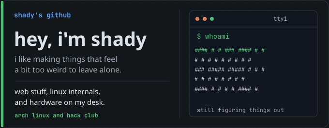
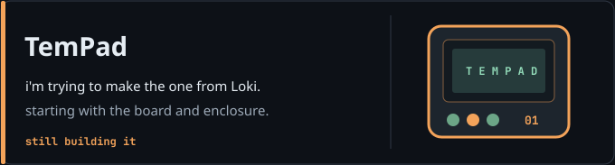
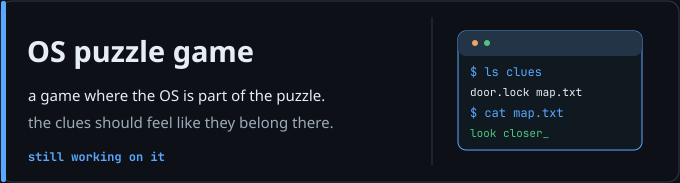
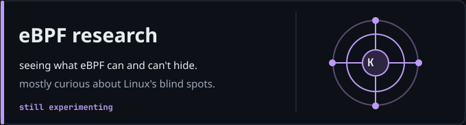
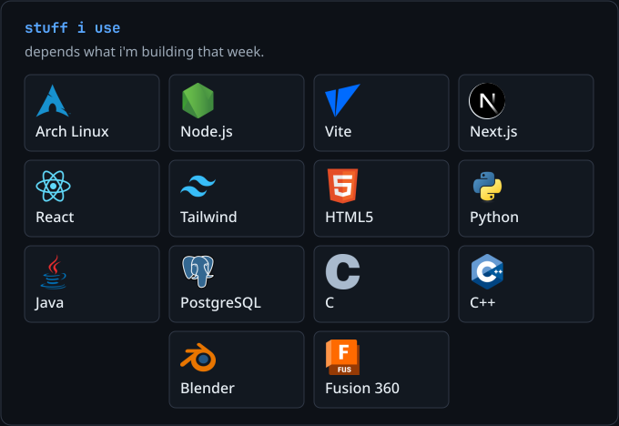

  

## hiiiii

i'm shady. i use arch linux, i'm part of Hack Club, and i keep ending up with projects that make me learn something completely different halfway through. right now that's a TemPad inspired by Loki, a game where the operating system is part of the puzzle, and some eBPF research.

### stuff i'm making

these are concept drawings for now. i'll swap them for real build photos, demos, and code as i go.

### what i've been up to

this pulls from my public GitHub activity each day. some projects stay on my desk for a while before they show up here.

### stuff i use

### stuff i'm learning

Altium Designer, PCB design, 3D printing, cybersecurity, and biohacking. i'm trying to use what i learn in the things i make.

### things i might try next

- make a tiny TemPad test board with a display, one input, and power. it'd be a good way to learn embedded C and Zephyr before taking on the full enclosure.
- get one OS puzzle level booting in QEMU, with clues hiding in files, logs, and a small shell instead of a normal game menu.
- build a little eBPF observer in a VM and compare what it sees with normal Linux tools. it'd give the rootkit research a second point of view.

if any of this sounds like your thing, [say hi here](https://github.com/shadysbasement/shadysbasement/issues/new).

Tech logos are from [Devicon](https://github.com/devicons/devicon). The activity cards use public GitHub data.
