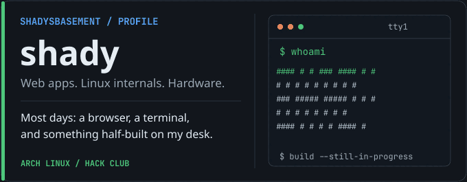
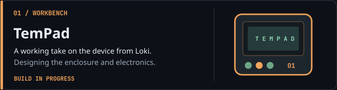
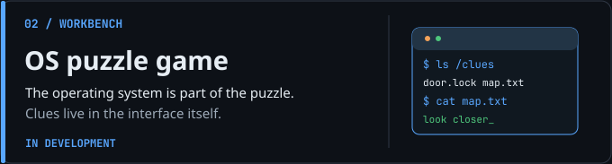
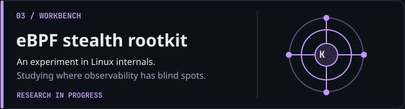
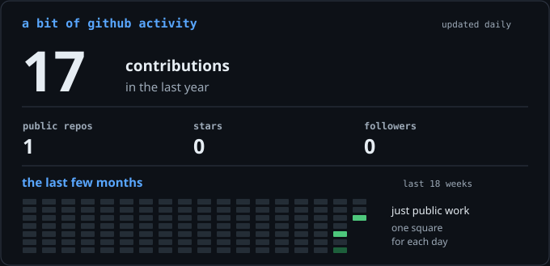
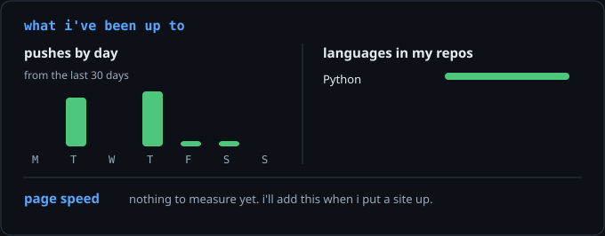

  

## hiiiii

I use Arch Linux and spend a lot of time moving between a browser, a terminal, and a workbench. I like web apps, odd interfaces, low-level systems, and making physical versions of things that started as fiction.

### On the workbench

These are illustrations of projects I'm still building. I'll replace them with build photos, demos, and code as I share them.

### Activity and contributions

The cards refresh from public GitHub data. [GitHub's contribution calendar](https://github.com/shadysbasement?tab=overview) is the live source. Languages will fill in as public source code appears. PageSpeed stays blank until I publish a site and add an audit.

### Tech stack

I'm learning Altium Designer, PCB design, 3D printing, cybersecurity, and biohacking.

### Next on my desk

- Publish TemPad build notes.
- Share a playable OS puzzle preview.
- Write up what I'm learning from the eBPF experiment.

If one of those sounds interesting, [open an issue here](https://github.com/shadysbasement/shadysbasement/issues/new).

Technology logos from [Devicon](https://github.com/devicons/devicon). Activity cards use public GitHub data.
