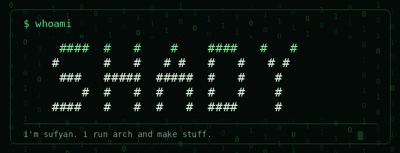
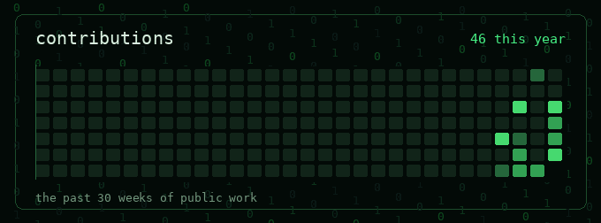
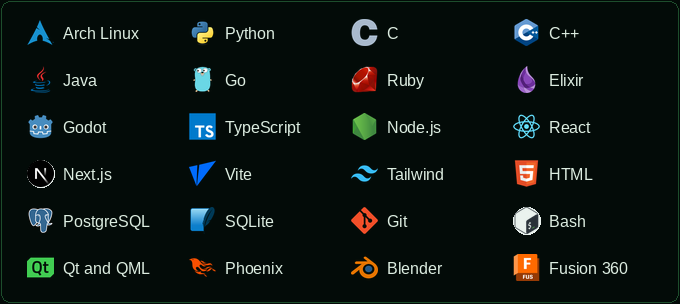

  

i'm sufyan. i use arch, make stuff, and keep getting curious about how things work under the hood.

  

### things i've used

the green squares come from my public GitHub contributions and refresh each day. logos from [Devicon](https://github.com/devicons/devicon).
